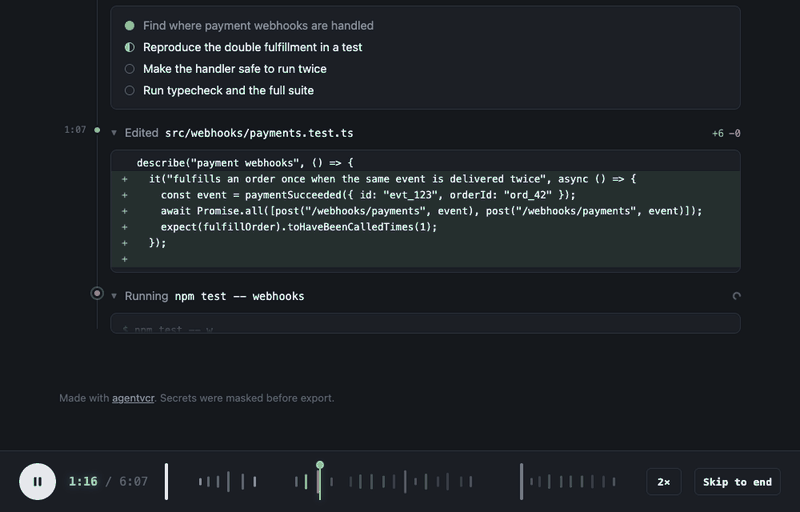

# agentvcr

[](https://github.com/tojacob03/agentvcr/actions/workflows/test.yml) [](https://www.npmjs.com/package/agentvcr-cli)  [](LICENSE)

**Replays for AI coding sessions, where review happens.** One command turns a Claude Code, Codex, Cursor, Gemini CLI or OpenCode session into a replay you can send as a link, embed, paste into a pull request as Markdown, or have commented on every PR an agent opens in CI. Secrets are masked on your machine. No account, no server, no dependencies.

```bash
npx agentvcr-cli               # pick a session from this project and open the replay
npx agentvcr-cli last --share  # or get a link to it
```

Or install it once and use the shorter command: `npm i -g agentvcr-cli`, then `agentvcr`.

[](https://tojacob03.github.io/agentvcr/demo/)

**[▶ Watch the example replay](https://tojacob03.github.io/agentvcr/demo/)**: Claude Code tracks down why a shop fulfills orders twice, reproduces it in a failing test, fixes it, and recovers from a type error on the way. The session is made up for the demo ([`examples/demo.mjs`](examples/demo.mjs)); the replay is exactly what agentvcr produces.

**[Try it on your own session](https://tojacob03.github.io/agentvcr/)**: drop a transcript on the TV on the website. It is parsed and played in your browser; nothing is uploaded.

## Why

An agent can work for an hour and leave behind nothing but a diff. Screenshots show one moment, and pasted logs are unreadable. agentvcr turns the whole session into something people will actually watch:

- **Show how you built it.** Put the replay next to your blog post, launch thread or PR.
- **Review the path, not just the result.** See which commands ran, what failed, and where the agent changed course.
- **Report a bug to your agent's makers** with the exact session, not a description of it.
- **Teach.** New teammates learn more from watching a good session than from a style guide.

## Usage

```bash
npx agentvcr-cli              # pick a session from the current project
npx agentvcr-cli last         # the most recent one
npx agentvcr-cli <file|id>    # a transcript file or a session id
npx agentvcr-cli --list --all # every session on this machine, all agents
```

It writes `agentvcr-<title>.html` and opens it in your browser. Pass `-o session.md` for a Markdown transcript instead, with each tool call folded into a `<details>` block, ready to paste into a pull request or docs page. Pass `-o clip.mp4` or `-o clip.gif` for a short clip to post: it plays the replay at 4× in your installed Chrome and encodes it with ffmpeg, no extra packages.

| Option | |
|---|---|
| `-s, --share` | upload the masked replay as a secret gist and print a link |
| `-o, --out <file>` | output path; `.md` writes a Markdown transcript, `.mp4` or `.gif` records a clip with your installed Chrome and ffmpeg |
| `-a, --all` | include sessions from every project |
| `--title <text>` | set the replay title |
| `--thinking` | include reasoning summaries when the transcript has them |
| `--subagents` | include subagent turns (Claude Code) |
| `--no-redact` | keep secrets, emails and your home path |
| `--no-open` | don't open a browser |

## Share a link

```bash
npx agentvcr-cli last --share
# ✓ https://tojacob03.github.io/agentvcr/v/?g=you/3f2a…
```

`--share` uploads the already masked replay as a **secret gist** on your GitHub account and prints a link to the player on this project's site, which loads the gist and plays it. There is no agentvcr server: GitHub stores it, Pages plays it, and deleting the gist takes the replay down. It uses the [GitHub CLI](https://cli.github.com) if you are logged in (`gh auth login`), or a `GITHUB_TOKEN` with the `gist` scope. `--share` cannot be combined with `--no-redact`.

Embed it in a blog post or docs page by adding `&embed` to the link; the CLI prints a ready `<iframe>` snippet:

```html
<iframe src="https://tojacob03.github.io/agentvcr/v/?g=you/3f2a…&embed" width="100%" height="640" style="border:0"></iframe>
```

Prefer a file? A replay is one HTML file with no external requests. Attach it to an issue, drop it on any static host, or send it.

## Supported agents

| Agent | Where sessions live | On the tape |
|---|---|---|
| Claude Code | `~/.claude/projects/` | prompts, answers, tool calls with output, diffs, plans; real working time |
| Codex CLI and app | `~/.codex/sessions/` | prompts, answers, shell output, `apply_patch` diffs, plans; real working time |
| Cursor | `~/.cursor/projects/*/agent-transcripts/` | prompts, answers, commands, edits, plans; Cursor keeps no tool output or step times, so the counter counts steps |
| Gemini CLI | `~/.gemini/tmp/*/chats/` | prompts, answers, shell, edits, searches, todos; rewinds and patches applied the way the CLI loads them |
| OpenCode | a database; run `opencode export <id> > session.json`, then `npx agentvcr-cli session.json` | prompts, answers, tool calls with output, shell commands, token usage |

Set `CLAUDE_CONFIG_DIR`, `CODEX_HOME` or `GEMINI_CLI_HOME` if yours live elsewhere. Aider and others: [PRs welcome](#how-it-works).

## Claude Code plugin

```text
/plugin marketplace add tojacob03/agentvcr
/plugin install agentvcr@agentvcr
```

Then `/agentvcr:replay` turns the session you are in into a replay, and `/agentvcr:replay share` gives you a link.

## GitHub Action: a replay on every agent PR

When an agent opens or updates pull requests in CI, put the run on tape:

```yaml
permissions:
  contents: write
  pull-requests: write

steps:
  - uses: anthropics/claude-code-action@v1
    id: claude
    with:
      anthropic_api_key: ${{ secrets.ANTHROPIC_API_KEY }}
  - uses: tojacob03/agentvcr@v0
    if: always()
    with:
      path: ${{ steps.claude.outputs.execution_file }}
      share-token: ${{ secrets.AGENTVCR_GIST_TOKEN }}  # optional
```

The action masks the run, attaches the replay to the workflow as an artifact and comments on the pull request with a summary, a link and the transcript folded inline, so reviewers can read how the change came about without downloading anything. With `share-token` (a token with the `gist` scope) the comment links straight to a shared replay. Leave `path` empty to replay the newest session of any supported agent on the runner. Outputs: `file`, `url`, `artifact-url`.

## What's in a replay

- A summary up top: what happened in one sentence, and a diffstat of every file changed. Click a file to jump to its first edit.
- Playback that types prompts and commands and streams answers, with 1×, 2×, 4× and 8× one click away and a counter that shows real working time
- The whole session as a waveform under the player: prompts tall and white, edits green, failures red. Drag to scrub.
- Real diffs for edits and patches, terminal output, plans and checklists, rendered Markdown
- Chapters to jump to each prompt, and token usage when the agent records it
- Links to exact moments: `replay.html#42`
- One self-contained file that works offline, in dark and light mode, and on phones

Keys: `space` play/pause, `←` `→` previous/next step, `1`–`4` speed, `Home` / `End`.

## Privacy

Everything runs locally unless you pass `--share`. Before anything is written, agentvcr masks:

- API keys and tokens (Anthropic, OpenAI, OpenRouter, Groq, Hugging Face, Replicate, GitHub, GitLab, Slack, AWS, Google, Stripe, Supabase, SendGrid, Mapbox, npm), JWTs, bearer tokens, private keys, and Slack and Discord webhook URLs
- `KEY=value` pairs whose name looks like a secret (`password`, `api_key`, `token`, …)
- credentials inside URLs, email addresses, your home directory and your username

The CLI tells you how many things it masked, and the [website](https://tojacob03.github.io/agentvcr/#privacy) lets you switch each rule off to see what it catches. Masking is pattern based, so **skim the replay before you share it**.

## How it works

Every agent writes its session as JSON lines. agentvcr reads them into one shared format (prompts, answers, tool calls with their results), masks secrets, and embeds the result in a small player. Parsing and masking are plain modules without Node APIs, so the same code runs in the CLI and on the website. The package is about 30 KB, and Node 18 or newer is all you need.

```bash
git clone https://github.com/tojacob03/agentvcr && cd agentvcr
npm test
node bin/agentvcr.js --help
npm run site   # rebuild the demo, the share viewer and the browser modules in docs/
```

Adding an agent means writing one parser that returns the shared format. [`src/cursor.js`](src/cursor.js) is a short example to start from.

## Contributing

Parsers for more agents are the most wanted contribution; [CONTRIBUTING.md](CONTRIBUTING.md) documents the shared session format and the steps. Good places to start: [good first issues](https://github.com/tojacob03/agentvcr/labels/good%20first%20issue) and [new agents](https://github.com/tojacob03/agentvcr/labels/new%20agent). Made a replay worth watching? [Share it in Discussions](https://github.com/tojacob03/agentvcr/discussions/5).

## License

MIT. Replays embed a subset of the [VT323](https://fonts.google.com/specimen/VT323) font, licensed under the SIL Open Font License 1.1 (see [`licenses/VT323-OFL.txt`](licenses/VT323-OFL.txt)).
